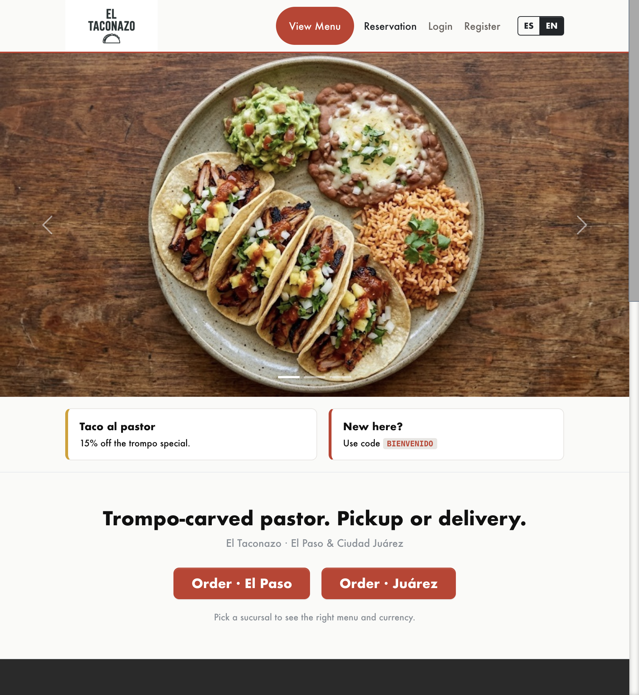
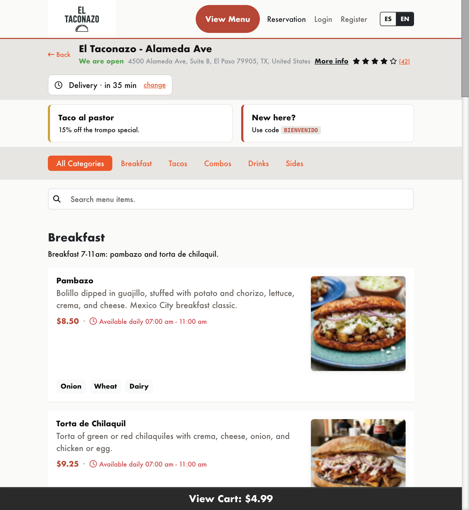
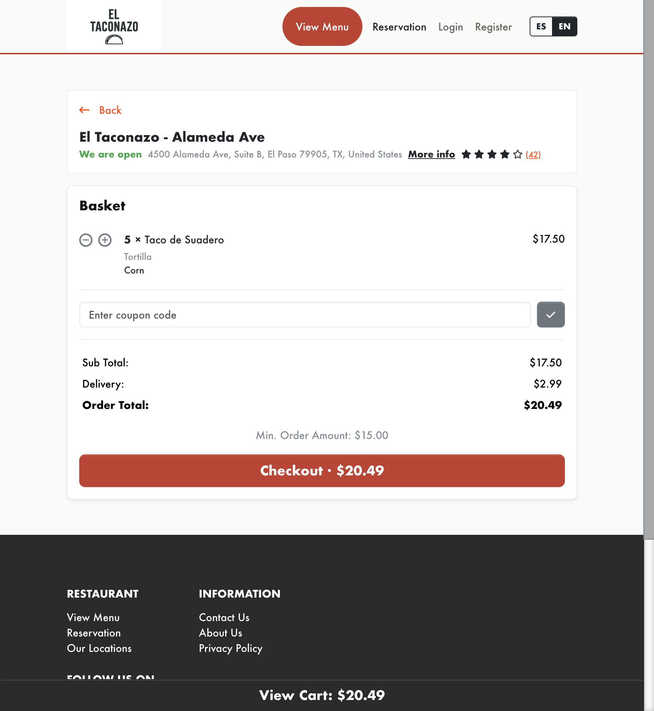
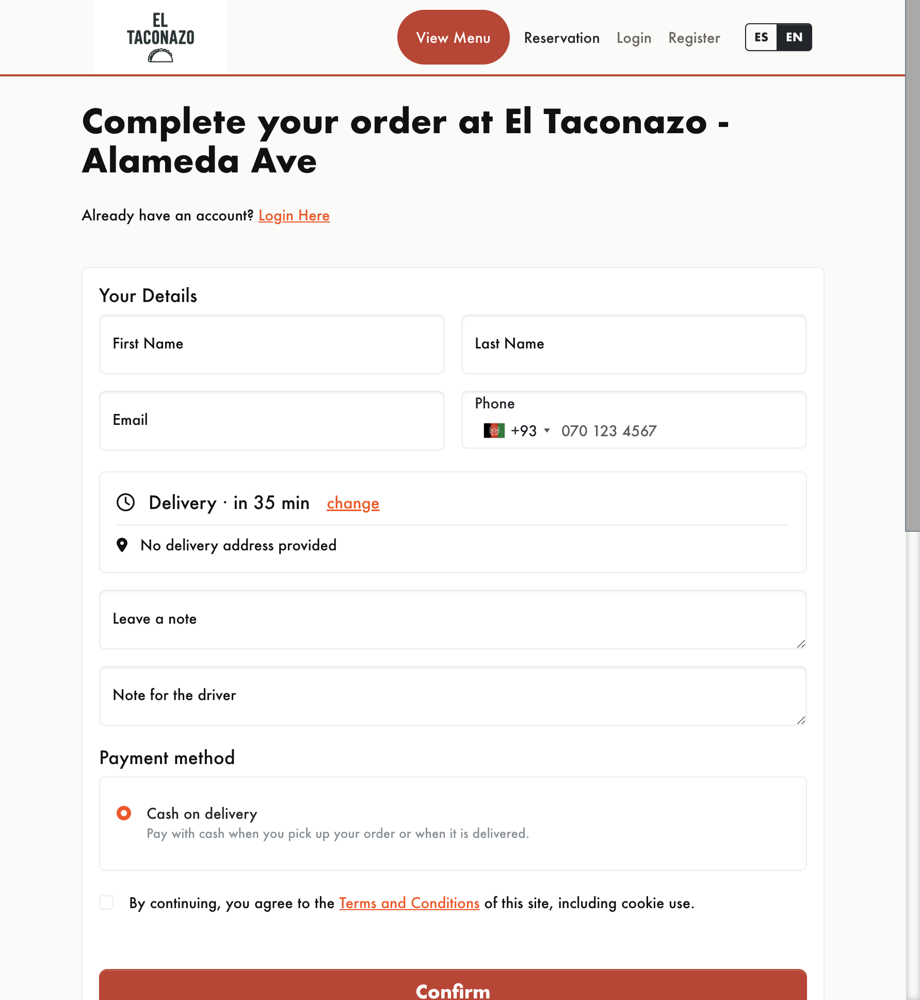
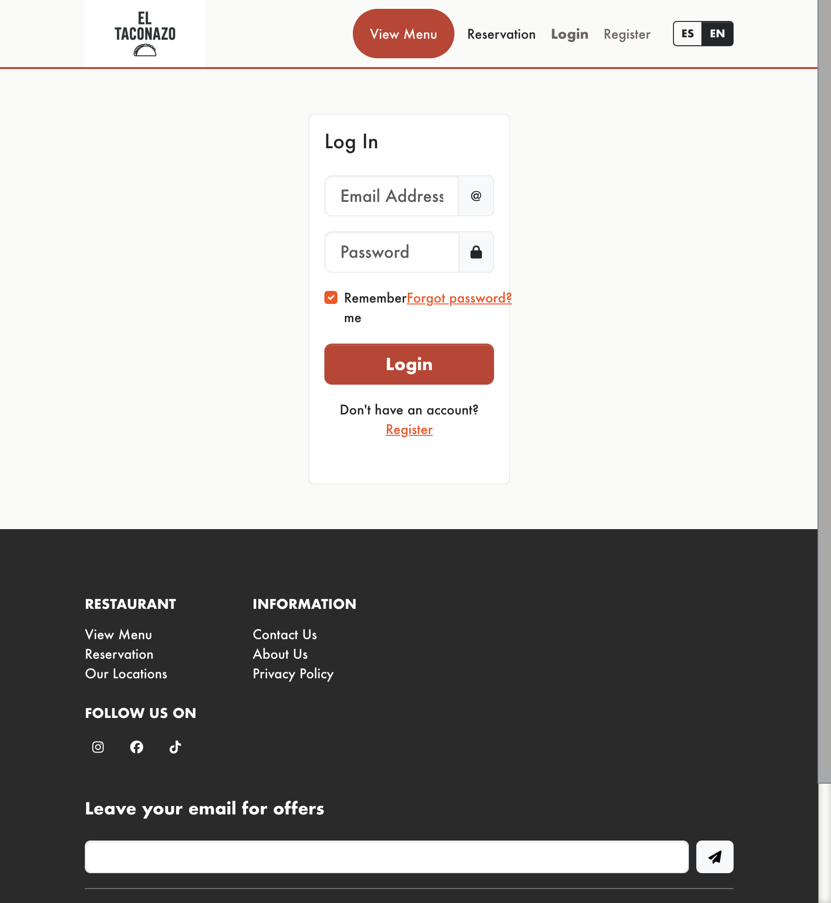
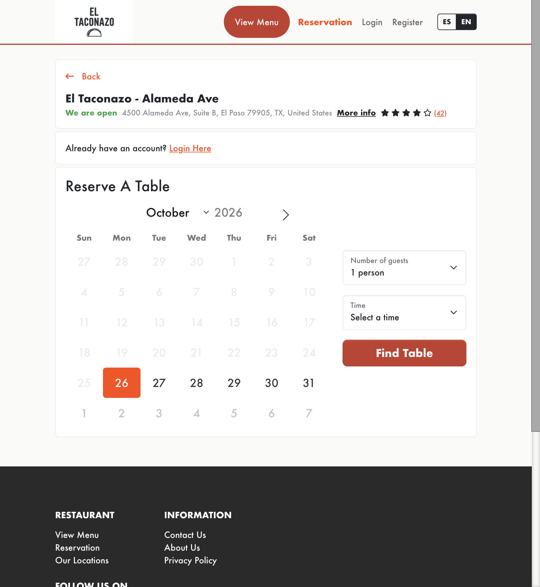
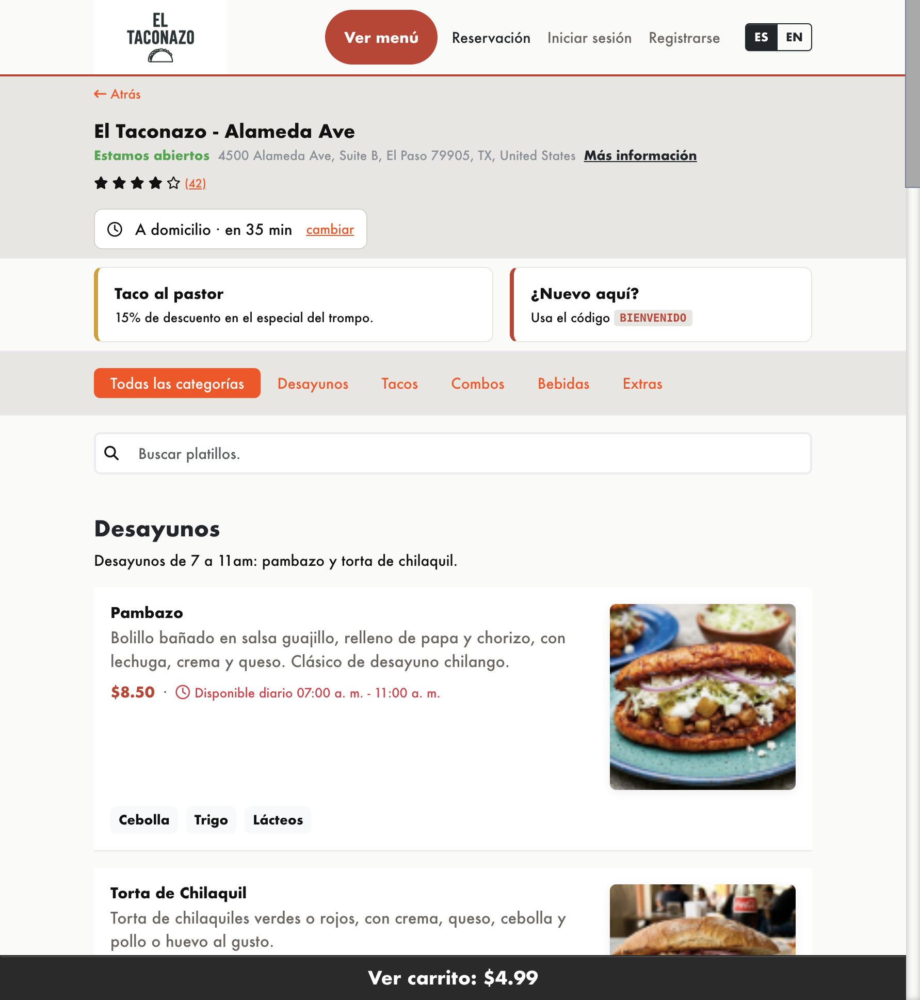

# What customers see

How a diner moves through a Dilibori storefront: finding a location, building an order, paying, booking a table, and coming back. Features are marked **Included** (ships in this stack), **Available when configured** (admin or gateway setup turns them on), or **Not part of Dilibori**.

For the owner side of the same product, see [owner and admin features](owner-admin-features.md). For the short pitch, see the [product overview](README.md).

---

## Finding the restaurant

**Included.** Each location has its own page and menus URL. The home page points guests at a location so they can start ordering for *para recoger* or *a domicilio*. Opening hours, delivery windows, and pickup windows show per branch. Guests pick a *sucursal* before they dig into the menu.

Why it matters: a two-branch brand does not dump every customer into one kitchen. The diner sees hours and availability for the place they will actually visit or receive from.

Pilot example: El Taconazo serves Alameda Ave (El Paso) and Tecnológico (Cd Juárez). Each branch has its own slug under `/menus`.

---

## Menu

**Included.** Categories (including parent and child categories), dish photos, descriptions, and per-item options. Option groups can display as dropdown, single choice, multiple choice, or quantity. Items can require a minimum quantity. You can restrict an item to delivery only or pickup only. Mealtimes control when a dish appears: a daily window, a fixed date period, or recurring weekdays. Specials run at a percent or fixed price for a period or forever. Ingredients and allergens can flag dishes (for example wheat or dairy). When stock tracking is on and quantity hits zero, the item blocks ordering.

Why it matters: the diner customizes a taco the way the kitchen actually cooks it, sees breakfast disappear after the window closes, and does not order something that already sold out.

Pilot example: El Taconazo has Breakfast, Tacos, Combos, Drinks, and Sides, with tortilla, salsa, and spice options. Breakfast runs from early morning; all-day items stay available.

---

## Cart

**Included.** Add, update, remove, and clear. Per-line comments and delivery notes. Coupon codes apply in the basket when the owner has created them. Minimum order rules and mealtime or order-type restrictions surface as clear alerts. Signed-in customers can have an abandoned cart restored when they return (when that setting is on).

**Available when configured.** Tip / *propina* at checkout, as a percentage or fixed amount, when tipping is enabled in cart settings.

Why it matters: the diner finishes the order without calling the shop to change a salsa, and promotions land in the same place as the total.

Pilot example: El Taconazo coupons such as `BIENVENIDO` (first-order percent off in El Paso), `BIENVENIDOJUAREZ` (Juárez counterpart), `TACOMIERCOLES`, and free-delivery codes. Tips are translated in the storefront language packs but not turned on in the seed.

---

## Delivery and pickup

**Included.** Delivery (*a domicilio*) and pickup (*para recoger*) per location, each with lead time, slot interval, minimum order, and cancellation window. Delivery areas use zones with their own fees and minimums. Guests can place ASAP orders or pick a timeslot; future orders can open several days ahead. When "reject orders outside delivery area" is on, checkout requires an address inside a zone. Guest checkout is supported so first-time diners do not have to register.

Why it matters: the diner knows the fee and the window before they pay, and the kitchen is not taking tickets it cannot fulfill.

Pilot example: El Taconazo seeds circular zones for El Paso (Central / Greater) and Juárez (Centro / Pronaf) with tiered fees. Delivery future orders can open up to three days; pickup up to two. Hours start from 7am for opening, delivery, and pickup in the rich seed.

---

## Checkout and payments

**Included.** Checkout form, confirmation page, and cash on delivery (*pago contra entrega*). Guest or account checkout. Order status labels the diner sees after placing the order.

**Available when configured.** Card and wallet gateways: Stripe, PayPal Express, Square, Mollie, and Authorize.Net. Per-location gateway selection. Saved payment profiles when the gateway supports them.

Why it matters: the diner can finish without creating an account, pay cash if that is how the shop works, or pay by card when the owner turns a gateway on.

Pilot example: the El Taconazo seed uses cash on delivery. Gateway UIs and language packs are present; card processors are not wired as live defaults in the demo.

---

## After ordering

**Included.** Order confirmation email to the customer. Status update emails when staff moves the ticket. Recent orders and order detail in the account area for signed-in guests.

**Available when configured.** Real-time status push to the diner when broadcast (Pusher, Ably, or Reverb) is set up.

Why it matters: fewer "is my order ready?" calls. The diner has a paper trail in email and, if they registered, in their account.

---

## Accounts

**Included.** Register, login, logout, remember me, password reset. Profile edit and password change. Address book with a default address. Recent orders and recent reservations. Inbox for account messages. Newsletter opt-in and terms acceptance on register. Registration can be turned on or off by the owner.

**Available when configured.** Email verification before the account activates. Customer invite by email. Social login providers (configured under social login settings).

Why it matters: regulars skip retyping the address and can reopen last week's order. First-timers still have guest checkout if they do not want an account yet.

Pilot example: El Taconazo demo account `juanagallo@gmail.com` (password in the app README) ships with order history for walkthroughs. Social login strings are localized; no OAuth providers are seeded.

---

## Reservations

**Included.** Public booking flow: party size, date, and time slot checked against table capacity. Confirmation page and email. Reservation history in the account. Owners set lead time, stay time, slot interval, guest capacity per slot, cancellation window, and whether tables auto-assign. Manual or automatic confirmation through the reservation status workflow.

Why it matters: Friday night does not get double-booked from a shared spreadsheet. The diner picks a slot the floor can actually seat.

Pilot example: El Taconazo seeds booking with party sizes 1 to 12, advance booking roughly 1 to 14 days, 15-minute slots, and a 60-minute stay. Dining areas include a main floor and a patio with tables that can auto-allocate.

---

## Reviews, newsletter, and content

**Included.** Reviews after a genuine order or reservation (quality, delivery, service), when the owner leaves reviews enabled. Newsletter subscribe in the footer. Static pages such as About, Privacy, and Terms. Contact form that emails the shop. Cookie notice (locale-aware) when GDPR-style banners are enabled on the theme.

**Available when configured.** reCAPTCHA on forms. Mailchimp sync for newsletter subscribers.

Why it matters: trust sits next to the menu, the mailing list belongs to the restaurant, and legal pages are on the same site as the order button.

Pilot example: the El Taconazo seed includes demo reviews and newsletter subscribers. About, Privacy, and Terms switch with the language picker.

---

## Language and currency

**Included.** This is how multi-branch Dilibori stays correct for the diner: language is a storefront choice the owner enables; currency follows the selected location.

Storefront languages are whatever the owner turns on. El Taconazo ships English (default) and Español (México) with a header language picker. Menu items, categories, and CMS pages can hold a translation per language, so switching locale updates the dish names and legal pages, not only the buttons.

Currency is per branch. Pick Alameda Ave and the cart is USD; pick Tecnológico and it is MXN. Distance units follow the site setup (miles for the USD location, kilometres for MXN). Coupons and minimums can be scoped per location so a Juárez first-order code does not apply in El Paso with the wrong floor.

Why it matters: a cross-border brand does not need two websites. The diner chooses a *sucursal*, sees the right language and the right money, and the kitchen that receives the ticket matches that branch.

Pilot example: switching to Español (México) updates chrome to wording such as *para recoger*, *a domicilio*, *platillos*, and *sucursal*. Choosing the Juárez location switches the cart to pesos while the same bilingual menu stays available.

---

## Look and feel

**Included.** Theme colors, logo, header accent, home slider, promotional banners (image or custom HTML), and footer social links (Instagram, Facebook, TikTok, and similar). Featured items and category lists on the Orange storefront theme, branded for the restaurant.

Why it matters: the ordering page looks like the restaurant, not a generic marketplace listing.

Pilot example: El Taconazo uses black primary branding and seeded home banners.

---

## Honesty tiers at a glance

| Tier | Examples |
|------|----------|
| Included | Multi-branch menus, per-location currency, multi-language storefront, cart, coupons, delivery zones, pickup, guest checkout, COD, accounts, reservations, reviews, newsletter, CMS pages |
| Available when configured | Card gateways, tips, social login, email verification, reCAPTCHA, Mailchimp, real-time status push |
| Not part of Dilibori | Group ordering / shared basket, loyalty points, gift cards, kitchen ticket printers, POS / kitchen display, courier marketplace apps |

---

## Related docs

- [Product overview](README.md)
- [Owner and admin features](owner-admin-features.md)
