# What owners and staff use

The restaurant back office at `/admin`: orders, menu, stock, locations, reservations, customers, staff, payments, marketing, automation, and system settings. Features are marked **Included**, **Available when configured**, or **Not part of Dilibori**.

For the diner-facing side, see [customer features](customer-features.md). For the short pitch, see the [product overview](README.md).

The site has its own database and media storage. Day-to-day work stays in this admin. Event streams (later in this doc) are how you watch the storefront and flag failures.

---

## A day on Dilibori

Morning. The manager opens Inventory, marks last night's *horchata* low, and sets a threshold so the next low-stock email fires before lunch. Breakfast mealtimes are already on; lunch items stay hidden until their window.

Lunch rush. Orders hit the Sales order board. Auto-refresh keeps the list current. For a new ticket the workflow popup offers Accept, Reject (with a reason), or Delay by a preset number of minutes. Kitchen capacity limits stop a timeslot from overfilling. Confirmation mail already went to the customer; status updates go out as the ticket moves.

Afternoon. A price change on the *pastor* combo is edited once, with English and Mexican Spanish fields, and attached to both El Paso and Juárez. The Alameda Ave cart shows dollars; Tecnológico shows pesos. A Wednesday coupon (`TACOMIERCOLES`) stays scoped to the right locations and redemption limit.

Evening. Reservations fill the patio. Tables auto-assign when that setting is on. Staff confirm or cancel from the reservation list; the guest gets the status email. Reviews from yesterday's orders sit under Marketing for a quick look.

---

## Dashboard and reports

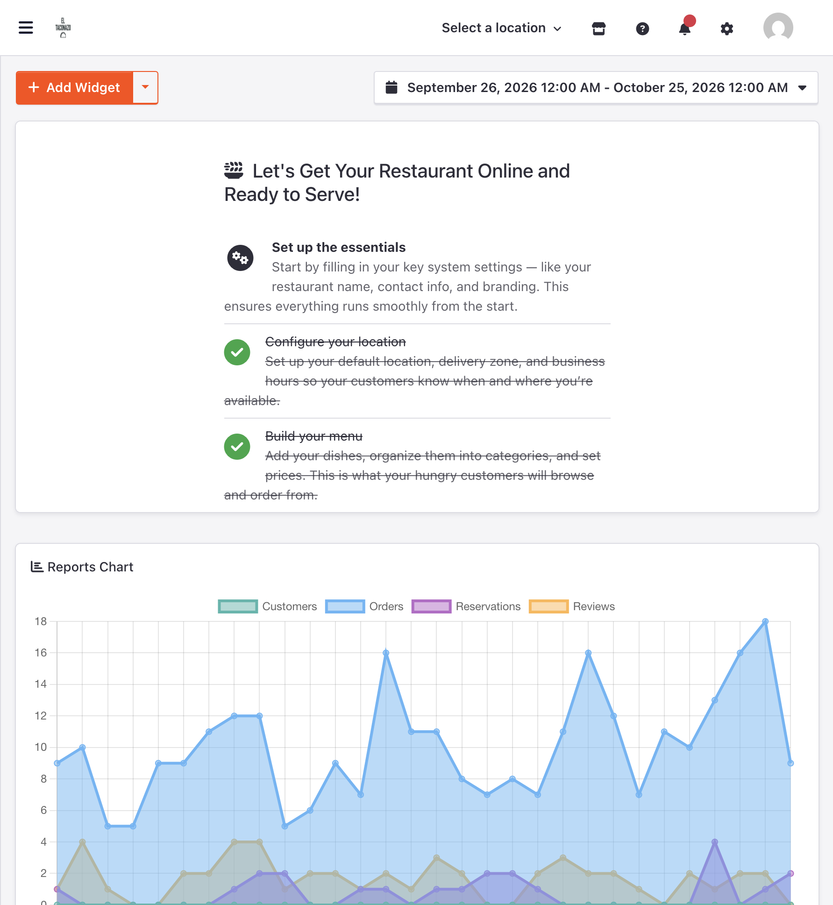

**Included.** Onboarding checklist, charts for orders / reservations / customers, stat cards (sales, lost sales, cash payments), recent activity, top customers, latest orders, and cache usage. Date ranges cover seven days, thirty days, and this year. Order charts break down by day, hour, category, and payment. Dilibori white-labels the dashboard (no third-party news widget; charts use the full width).

Why it matters: one screen answers "how was lunch?" without exporting a spreadsheet first.

---

## Live orders

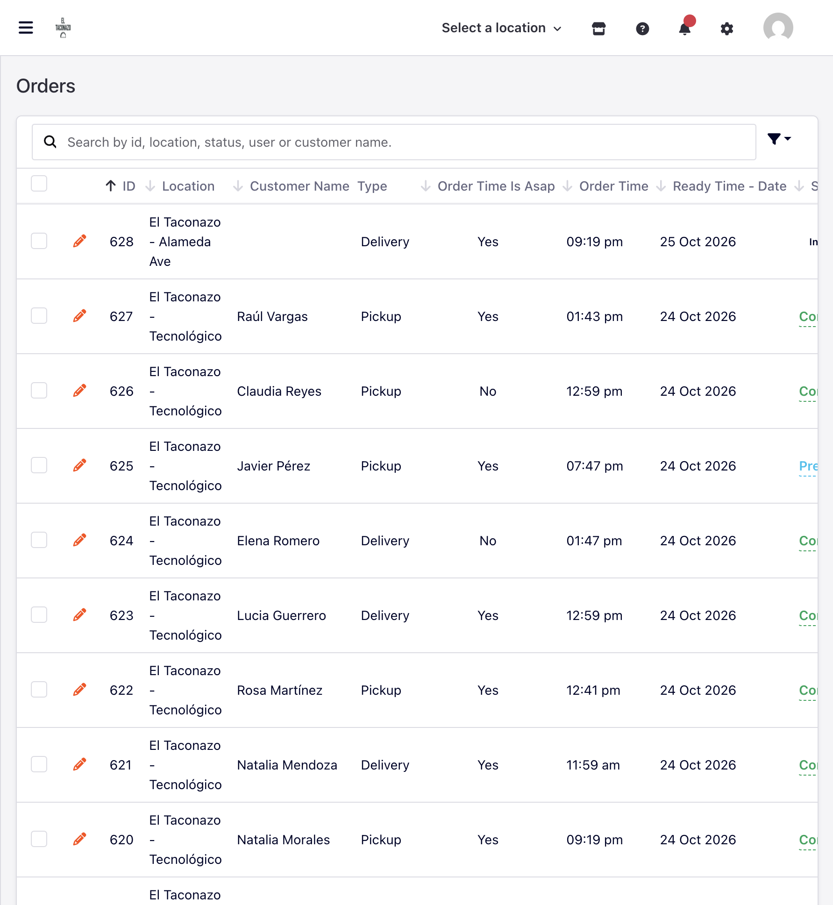

**Included.** Filter by order type, assignee, and status. Auto-refresh interval. Assign staff. Status workflow with notify. Accept / reject / delay popup; reject reasons and delay presets are configurable. Workflow can be limited to selected staff. Map default, accepted, processing, completed, and cancelled statuses. Print or view invoice. Guest orders appear alongside account orders. Order limits per timeslot (kitchen capacity) at the location. Cancel from admin. Confirmation email to the customer; new-order alert to location and admin; status update email to the customer; low-stock alert when inventory fires.

**Available when configured.** Full and partial refunds from the order when a refundable gateway processed the payment. Real-time staff updates when broadcast is configured.

Why it matters: the ticket does not live in a group chat. Accept, delay, or reject with a reason, and the diner hears about it without a phone call.

---

## Menu and catalog

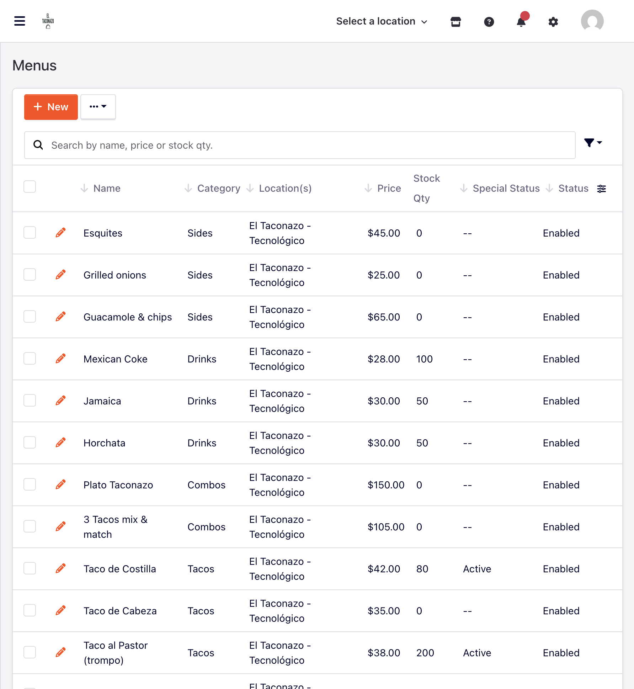

**Included.** Menu items, categories (with parent / child), option groups (dropdown, radio, checkbox, quantity), mealtimes (daily, period, or recurring), ingredients and allergens, specials, photos, priority / sort order, active flag, minimum quantity, stock quantity, and order restriction (delivery, pickup, or both). Attach items, categories, options, and mealtimes to specific locations or leave them global. Bilingual editing for translated fields (English and Mexican Spanish on El Taconazo) through locale-aware admin fields.

Why it matters: one catalog, many branches, without maintaining two PDFs.

Pilot example: El Taconazo breakfast window, taco option groups, and specials come from the rich seed.

---

## Inventory

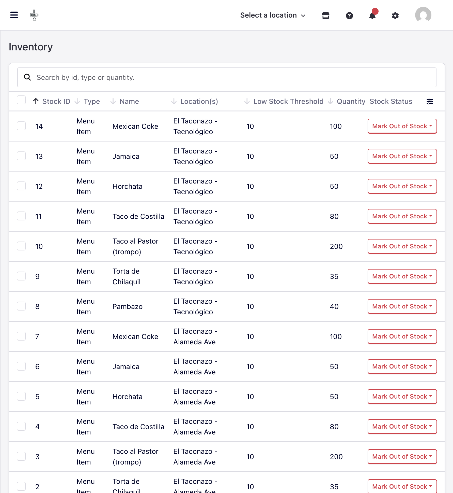

**Included.** Stock per menu item and option value. Stock history. Bulk stock update actions. Low-stock threshold with email to admin. Out-of-stock items block the cart when tracking is on. Admin path surfaces under Kitchen / Inventory style navigation (Stocks).

Why it matters: selling a sold-out *horchata* creates refunds and angry reviews. Marking it out once removes it from ordering.

---

## Locations

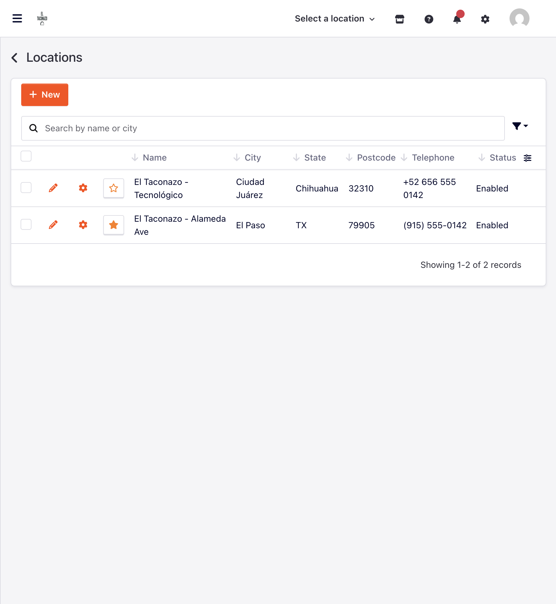

**Included.** Multi-branch is a first-class feature: create and edit locations with address and map coordinates, then run them under one admin. Schedules for opening, delivery, and pickup. Delivery areas (circle or polygon) with fees and minimums. Offer delivery, pickup, future orders, and reservations per branch. Guest checkout, order limits, and payment gateway selection per location. Location gallery. Single-location mode for one-branch shops, or multi-location for chains. Geocoder settings (including Google Maps API key when that provider is selected). Distance unit (mi or km) is a site setting.

Language and currency sit with this model. Enable the storefront languages you need (English and Spanish (Mexico) on El Taconazo) and maintain translations on menu and CMS fields in admin. Set a currency per location so Alameda Ave checks out in USD and Tecnológico in MXN without a second site. Coupons, menus, and staff assignment can be scoped to specific branches.

Why it matters: El Paso and Juárez are not the same kitchen, fee table, language mix, or currency. Each location keeps its own rules under one login. That is the headline capability for border and multi-city brands.

---

## Reservations and dining floor

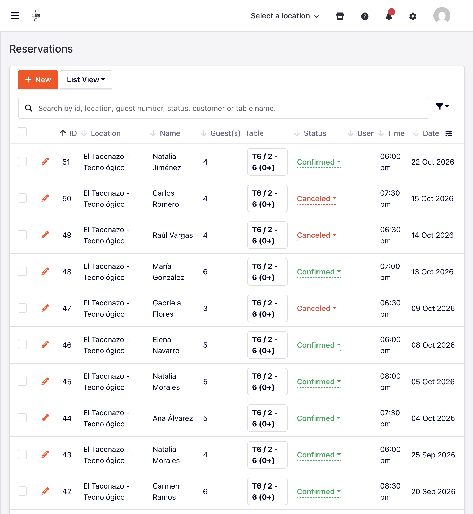

**Included.** Reservation list and calendar-style management. Assign staff and tables. Status workflow. Emails: guest confirmation, admin alert, guest status update. Dining areas, sections, tables, table combos, and floor layout. Auto-assign tables from party size and availability. Location settings for enable booking, interval, stay time, guest capacity per slot, lead time, and cancellation window. Global reservation settings for mail and default statuses.

Why it matters: the patio seats what it can seat. Overbooking shows up as a denied slot, not a fight at the host stand.

Pilot example: El Taconazo Main Floor and Patio; demo activity seeds reservations for both locations.

---

## Customers and staff

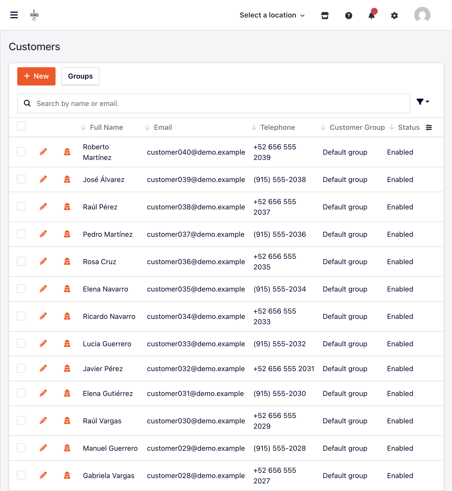

**Included.** Customer list, search, detail, addresses, and customer groups (optional approval before activation). Impersonate a customer for support. Staff users, groups, and roles with permissions. Sale scope: all orders, group only, or assigned only. Assign staff to locations. Invite staff by email. Staff password reset. Per-staff language for the admin UI. Impersonate staff when permitted. Activity around logins and assignments shows in the activity tools.

Why it matters: a cashier does not need the same access as the owner. A support call can open the customer's view without guessing their password.

---

## Payments

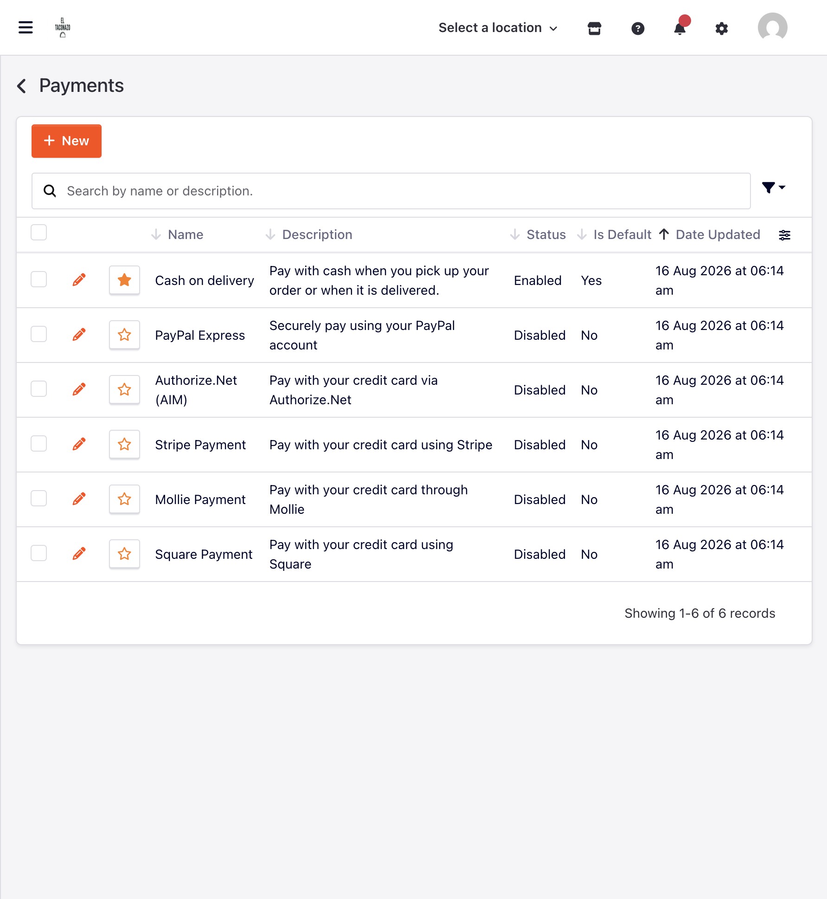

**Included.** Payment settings admin. Cash on delivery. Per-location enablement of gateways. Payment attempt log on the order.

**Available when configured.** Stripe, PayPal Express, Square, Mollie, Authorize.Net. Saved payment profiles where the gateway supports them. Full and partial refunds from the order screen.

Why it matters: cash-heavy shops and card-first shops use the same checkout; you turn on what you are ready to reconcile.

Pilot note: the seed uses COD. Card processors need credentials before they take live money. Broader billing outside gateway config is out of scope.

---

## Marketing

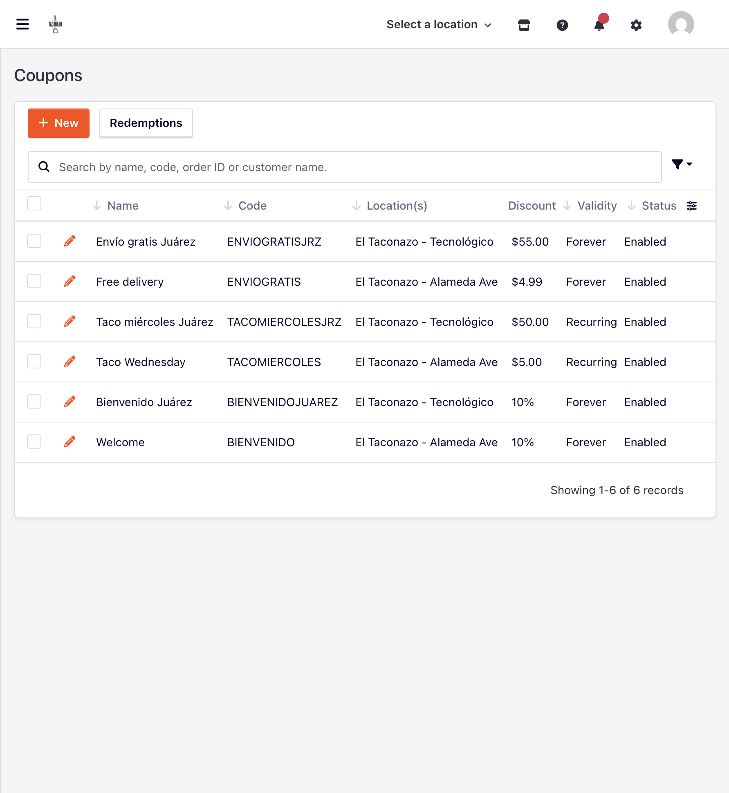

**Included.** Coupons: percent or fixed, forever / period / recurring weekday validity, min total, per-customer and global redemption limits, location / menu / category / customer restrictions, apply to delivery fee, auto-apply when configured, redemption history. Reviews list and review settings (enable or disable order and reservation reviews). Homepage banners (image or custom HTML) and sliders. Newsletter subscribe on the storefront; subscribers appear for the shop to use. Static pages and static navigation menus (About, Privacy, Terms). Contact form mail to the shop.

**Available when configured.** Mailchimp list sync. reCAPTCHA on public forms.

Why it matters: promotions are rules the cart enforces, not a verbal "tell them at the window." Reviews and the mailing list stay on your domain.

Pilot example: `BIENVENIDO`, `TACOMIERCOLES`, `ENVIOGRATIS`, and the Juárez variants, for El Taconazo.

---

## Automation

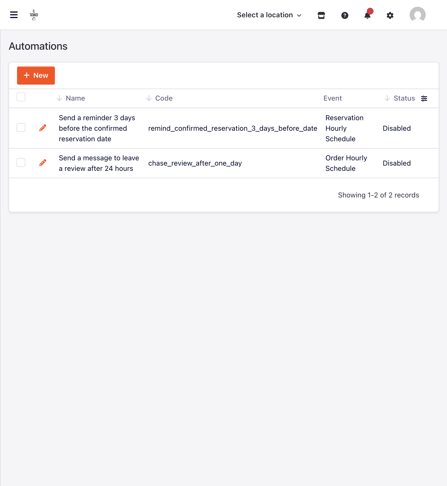

**Included.** Rules under Tools > Automations: pick an event (new order, status update, order assigned, new reservation, customer registered, and similar), add conditions, run actions such as email a template or assign staff / group. Run history shows success and errors. The app image already runs a queue worker so jobs can process in the background.

Why it matters: "email the kitchen group when a delivery order hits Alameda" does not need a developer for every rule.

---

## Settings and system

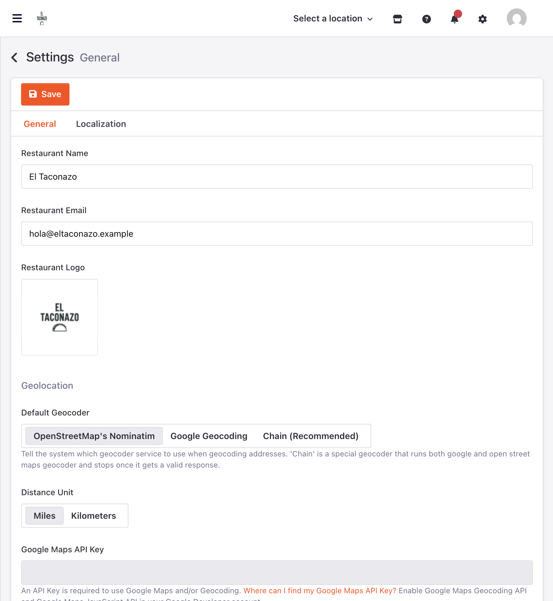

**Included.** Site name, email, logo, timezone, countries, currencies, languages. Mail drivers and editable mail templates / variables (order, reservation, stock, staff reset, registration, and related). Tax and invoice settings. Guest order and registration toggles. Language detection settings. Order and reservation statuses. Theme customization (Orange theme branded for the restaurant). Media manager. Maintenance mode. Activity and request logs. System info / health page. Extensions list is present in admin chrome.

**Available when configured.** Cart conditions rename, reorder, and enable/disable (coupon, tax, tip, payment fee). Tip presets (percent or fixed). Broadcast settings (Pusher, Ably, or Laravel Reverb) for real-time updates.

Why it matters: the shop controls mail copy, tax behavior, and storefront theme without opening a ticket for every string change.

---

## Connect your tools

**Included.** REST API under Tools > APIs for categories, coupons, customers, locations, location settings, menus, orders, reservations, and reviews. Staff and customer access tokens with ability scopes. Token create and revoke flows.

**Available when configured.** Broadcast so staff and customers receive live updates on private channels once a provider is configured and the queue is running.

Why it matters: a custom tablet board or an internal report can read orders without scraping the admin HTML. Real-time push is optional wiring on top.

---

## Eventing, alerting, and monitoring

Dilibori streams storefront and ops events so the business (and whoever runs the stack) can see the funnel and the failures. This is not a BI dashboard inside `/admin`. The restaurant admin remains the day-to-day tool; the event stream and health checks are the observation layer.

### Funnel and account events

**Included** in the analytics pipeline when CDP is enabled:

- Page views and product list views
- Product added / removed, cart viewed / cleared
- Location selected, order type selected, delivery area selected, timeslot selected
- Checkout started, payment started, order completed
- Coupon entered / applied / denied / removed / redeemed
- Account created / logged in / logged out
- Reservation booked and related reservation signals
- Review submitted, newsletter subscribed

Shared context on tracks typically includes location, currency, locale, and order type when known. Anonymous and logged-in activity stitch through an identity cookie.

### Ops and failure signals

- Order status updated (useful for kitchen timing / SLA views)
- Order cancelled, order refunded
- Application Error with a stable fingerprint, so you can find everyone who hit the same failure. Expected UX failures (item out of stock, shop closed) can be filtered apart from unexpected bugs.

### Monitoring and health

The admin system info page reports PHP, extensions, and runtime checks. Application Error events (above) are the signal when a storefront action fails.

Why it matters to an owner: when "add to cart is broken for Juárez" shows up as a cluster of Application Error fingerprints, you fix the cause instead of guessing from a handful of phone complaints.

---

## Honesty tiers at a glance

| Tier | Examples |
|------|----------|
| Included | Dashboard, order workflow, menu, stock, multi-branch locations with per-location currency and multi-language content, reservations, customers / staff RBAC, COD, coupons, reviews, CMS, automation, API, mail templates, CDP event stream, system health page |
| Available when configured | Card gateways, refunds, tips, Mailchimp, reCAPTCHA, social login, broadcast / real-time push |
| Not part of Dilibori | Group ordering, kitchen ticket / receipt printers, loyalty points, gift cards, POS / kitchen display, courier integrations |

---

## Related docs

- [Product overview](README.md)
- [Customer features](customer-features.md)
