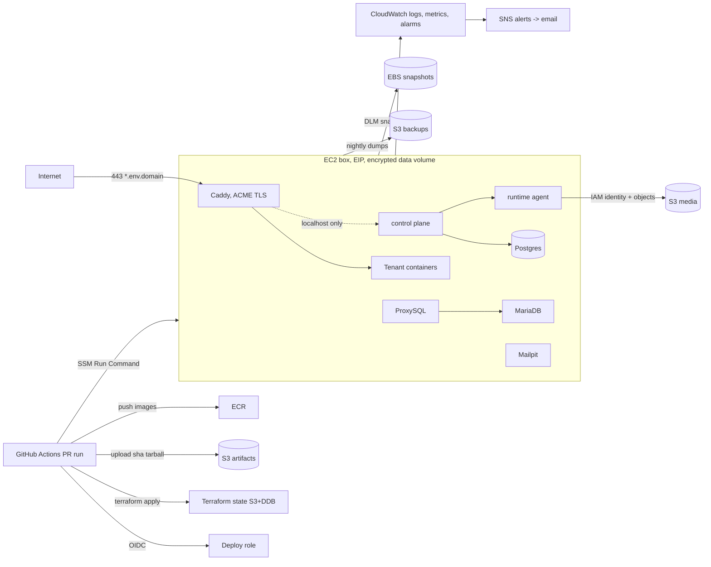

# Platform architecture

How the multi-tenant platform is shaped locally and on AWS. Operations (bootstrap, PR deploy, runbooks) live in [`infra/README.md`](../../infra/README.md).

## Diagram (AWS single box)

## Local vs AWS

| Concern | Local | AWS |
|---------|-------|-----|
| Host | Docker Desktop / compose project per env | One EC2 box per account (dev, prod) |
| Ingress | Caddy on `:8088` / `:8188`, `http://*.localhost` | Caddy on 80/443, ACME TLS, `*.domain` |
| MariaDB | Container | Same container on the box |
| Postgres | Container | Same container on the box |
| Object store | MinIO + `mc admin` users | S3 + IAM users (`OBJECT_STORE_IDENTITY=iam`) |
| Mail | Mailpit | Mailpit (dev) / SES SMTP (prod) |
| Secrets | `platform/.env` + encrypted files under `data/*/secrets` | Secrets Manager → `/etc/dilibori/box.env` + same encrypted files on the data volume |
| Cache / queue | File cache + MariaDB `jobs` table (no Redis) | Same |
| RudderStack | Optional `cdp/` compose | Not deployed; `CDP_ENABLED=false` |
| Deploy | `make up` | PR → GitHub Actions → SSM `deploy.sh` |

## Components

### Ingress (Caddy)

- **Role:** Host-based routing to tenant containers; TLS termination on AWS.
- **Local:** [`platform/ingress/Caddyfile`](../ingress/Caddyfile), port from `envs/*.env`.
- **AWS:** [`platform/ingress/Caddyfile.aws`](../ingress/Caddyfile.aws), ports 80/443, certs in named volume `caddy_data`.
- **Trust:** Tenant snippets are written only by the runtime agent under `data/.../ingress/tenants/`. Admin API on `localhost:2019`.
- **ponytail:** Let's Encrypt allows 50 certs per registered domain per week. Upgrade: Caddy with the Route53 DNS plugin for a wildcard cert.

### Box / compose stack

- **Role:** Shared data plane for one environment: MariaDB, ProxySQL, Postgres, PgBouncer, MinIO (local), Mailpit, Caddy, control plane, runtime agent.
- **Local:** `make -C platform up ENV=dev|prod`.
- **AWS:** Same compose via `ENV=aws-dev|aws-prod` and [`docker-compose.aws.yml`](../docker-compose.aws.yml). Admin ports bind to `127.0.0.1`; reach them with SSM port-forward.
- **Trust:** Security group allows 80/443 only. No SSH; SSM Session Manager only. IMDSv2 required.

### Runtime agent

- **Role:** Privileged Docker apply path. Creates networks, DBs, object-store identity, tenant containers, Caddy routes, backups.
- **Auth:** Bearer `RUNTIME_AGENT_TOKEN`. Image/env/mount allowlists in `allowlist.py`.
- **AWS extras:** `INGRESS_SCHEME=https`, `OBJECT_STORE_IDENTITY=iam`, `CDP_ENABLED=false`, mail settings for SES.

### Tenant containers

- **Role:** One immutable TastyIgniter container per deployment.
- **Isolation:** Per-deployment bridge network, MariaDB user + `MAX_USER_CONNECTIONS`, object-store prefix credentials, bind mounts for `storage`, cache, media.
- **Cache / queue:** `CACHE_DRIVER=file`, `QUEUE_CONNECTION=database` (jobs table created at provision). No Redis. Upgrade path when DB poll load bites: per-tenant SQS (same IAM pattern as S3), not ElastiCache.

### ProxySQL + MariaDB

- **Role:** Shared MariaDB; tenants connect through ProxySQL with per-user connection budgets.
- **Trust:** DDL goes to MariaDB as root from the agent; app traffic uses ProxySQL on 6033.

### Object storage

- **Role:** Prefix-scoped credentials for future media; snapshot export/import of the prefix; purge.
- **Local:** MinIO + `mc admin` (`OBJECT_STORE_IDENTITY=minio`).
- **AWS:** S3 bucket + IAM user per tenant with an inline prefix policy (`OBJECT_STORE_IDENTITY=iam`).
- **Note:** Tenants still store media on a bind mount today. Wiring `FILESYSTEM_DISK=s3` is a follow-up.

### Control plane

- **Role:** Desired state, provisioning state machine, reconcile, admin UI.
- **Data:** Postgres via PgBouncer. Secrets encrypted on disk (`SECRETS_PATH`) with `APP_SECRET_KEY`.
- **AWS:** Bound to localhost; use SSM port-forward to open the UI.

### Control-plane Postgres

- Schema from `control-plane/database/schema.sql`, cell seed from `seed.sh` (`INGRESS_BASE_URL` overridable).

### Mail

- **Local / AWS dev:** Mailpit.
- **AWS prod:** SES SMTP via `TENANT_MAIL_*` (domain verification is a manual console step).

### Secrets

- Platform credentials: Secrets Manager JSON `dilibori/<env>/platform`.
- Tenant secrets: AES-GCM files under the data volume (same as local).

### Logs, metrics, alerts

- CloudWatch agent (memory, disk), `awslogs` on compose services, custom `dilibori/health` metrics from `health-metrics.sh`, SNS email alarms, AWS Budgets.

### CDP (not deployed on AWS)

Local RudderStack under [`cdp/`](../../cdp/) is optional. On AWS, tenants get `CDP_ENABLED=false`; the extension no-ops (boot, JS snippet, PHP client). How to turn it on later is in [`infra/README.md`](../../infra/README.md#adding-rudderstack-later).
